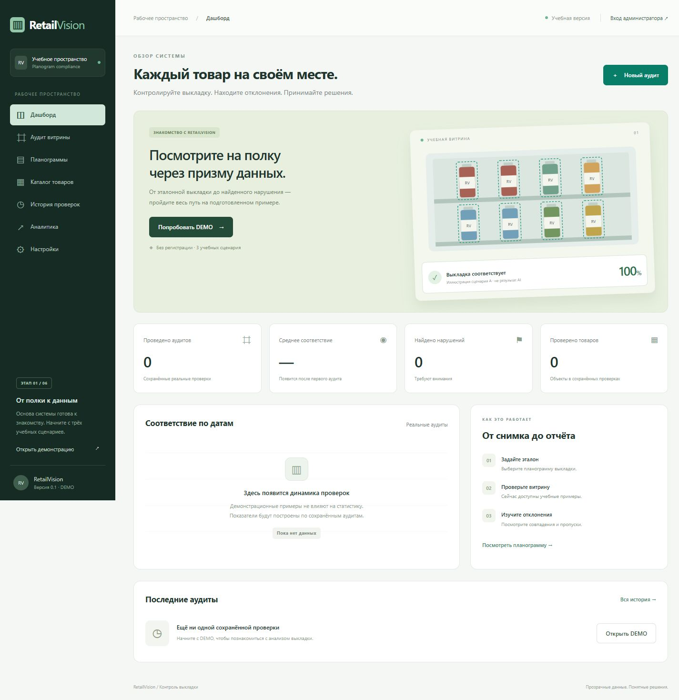
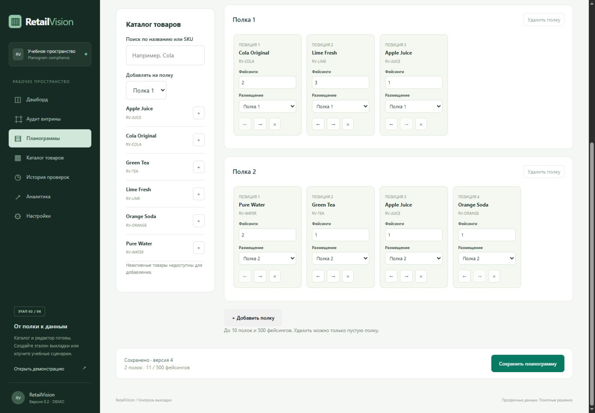
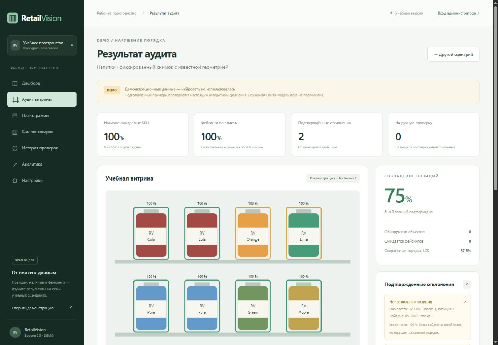
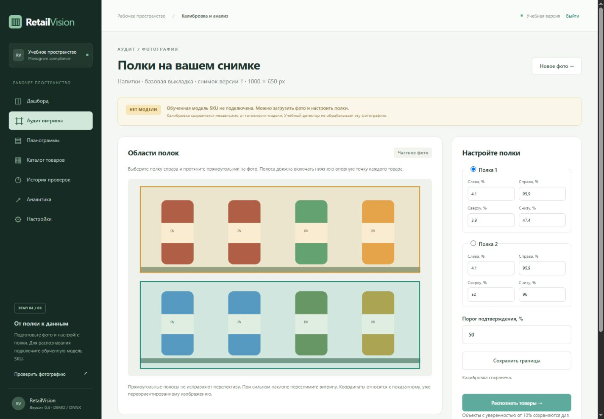
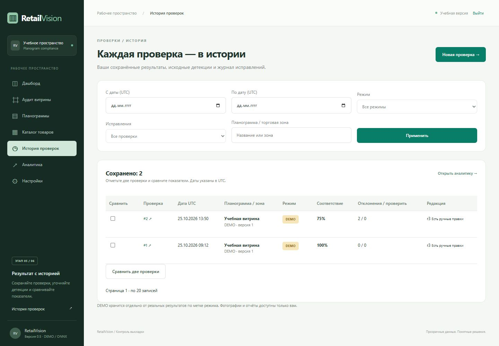
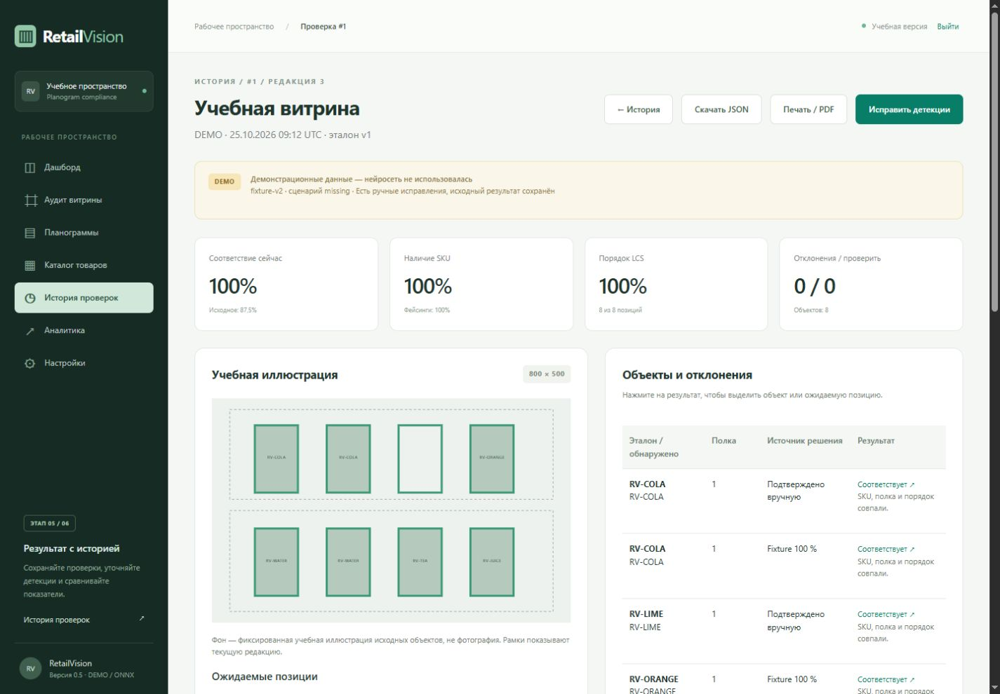

# RetailVision

Система контроля выкладки товаров (Planogram Compliance), ASP.NET Core MVC / .NET 10.

[](https://github.com/BobrovNikita/retail-planogram-audit/actions/workflows/ci.yml)

**Публичный репозиторий:** https://github.com/BobrovNikita/retail-planogram-audit

**Для демонстрации и сдачи:** [готовность по ТЗ, сценарий показа, руководство, вопросы защиты и передача проекта](docs/delivery/README.md). Переносимый комплект исходников и проверенной модели собирается скриптом `scripts/package-handoff.py`; база и пароли в него не входят.

Реализованы этапы 1–6: каталог, редактор планограмм, алгоритм аудита, приватная загрузка фото, ONNX-инфраструктура, история, отчёты, ручные исправления и контейнерная подготовка к публикации. [План и результаты](docs/development-plan.md). Локально подключена экспериментальная модель восьми продуктов HoloSelecta v2: на 29 ранее использованных снимках mAP@50 95,6%, C# precision 95,4% / recall 80,8% при пороге 50%. Нужна независимая проверка на новых полках; готовность к автоматической приёмке не подтверждена. [Выбор модели, исправление и ограничения](docs/experiments/holoselecta-v2/README.md). Веса и фотографии в Git не включены. Реальный VPS не развёрнут.

## Что работает

- Русский адаптивный MVC-интерфейс: дашборд, каталог с поиском и фильтрами, карточки/таблица, планограммы, DEMO-аудит.
- Администратор создаёт, редактирует, отключает и удаляет товары с учётом связей; загружает приватные изображения и настраивает соответствие классов моделей SKU.
- Визуальный редактор: drag-and-drop, кнопки перемещения, полки, фейсинги, версии, дублирование, импорт/экспорт JSON.
- Шесть учебных SKU, две полки, восемь фейсингов; авторские SVG-упаковки без чужих фотографий.
- Семь воспроизводимых примеров: правильная выкладка, пропуск, перестановка, замена SKU, другая полка, лишний фейсинг и низкая уверенность.
- Сопоставление на основе LCS и геометрии, шесть типов нарушений, отдельные случаи для ручной проверки.
- Показатели позиций, порядка, наличия SKU и фейсингов; статистика по полкам, SVG-подсветка и полная таблица сопоставления.
- SQLite, EF Core migration, идемпотентное заполнение, отдельное соответствие классов модели и SKU.
- ASP.NET Core Identity; защищённые настройки; CSRF, rate limiting, CSP и безопасная обработка ошибок.
- Администратор загружает фото, рисует границы полок или задаёт их числами; черновик сохраняет снимок эталона и доступен владельцу 24 часа.
- ONNX Runtime CPU с проверкой SHA/контракта/классов, ограничением очереди и отменой; RGB/NCHW/letterbox, обратные координаты и рамки на фото.
- Python-инструменты проверки датасета, обучения, validation, экспорта и сравнения PyTorch/ONNX.
- Постоянные приватные отчёты в SQLite, копии фото, фильтры истории, сравнение проверок, аналитика по режимам и JSON-экспорт.
- Ручная коррекция SKU/рамок, добавление и удаление объектов, пересчёт, журнал до/после и восстановление оригинала; отдельный печатный HTML/PDF через браузер.
- Dockerfile с закреплёнными .NET-образами, app без root, Compose с постоянным томом, Nginx/HTTPS, доверенный proxy и файловый bootstrap-secret.
- Резервное копирование с остановкой app и восстановление только в пустой том; health check и отдельный контейнерный CI.
- 105 unit-тестов, 101 интеграционный тест и 15 Python-тестов. CI на Ubuntu при push/PR, плюс HTTPS/native/backup/restore smoke-проверки.

**DEMO не использует нейросеть и не принимает пользовательские фотографии.** Свои фото администратор загружает отдельно через /photoaudit. Успешный REAL-анализ сохраняется автоматически; учебный сценарий администратор сохраняет отдельной кнопкой с меткой DEMO. Публичные посетители не изменяют постоянные данные. Дашборд читает только собственные REAL-аудиты; незавершённые черновики в показатели не входят.













Работа с каталогом, ограничения загрузок и формат JSON описаны в [руководстве редактора](docs/catalog-and-editor.md).

Для собственной фотографии войдите администратором и откройте /photoaudit. Настройка полок доступна без модели. Для распознавания подготовьте проверенный manifest по [инструкции ML](ml/README.md), задайте абсолютный Vision__ManifestPath и перезапустите сайт. [Контракт ONNX и ограничения](docs/ml-pipeline.md).

## Локальный запуск

Требуется .NET SDK 10.0.400.

```sh
dotnet restore --locked-mode
dotnet build --configuration Release
dotnet test --configuration Release --no-build
dotnet run --project src/RetailVision.Web --configuration Release --no-build
```

Откройте http://localhost:5180. Профиль запуска включает Development и привязку к localhost. База создаётся миграцией при первом запуске в `src/RetailVision.Web/App_Data/retailvision.db`. Повторный запуск не удаляет данные. `/health` проверяет доступность БД.

Путь к данным можно изменить через `Storage__DataDirectory` (предпочтительно абсолютный путь вне webroot). Не запускайте несколько экземпляров приложения с одной SQLite-базой на этом этапе.

## Docker и HTTPS

Из корня репозитория скопируйте `.env.example` в `.env`, подготовьте `fullchain.pem`/`privkey.pem` в каталоге TLS_DIRECTORY и выполните `docker compose up -d --build --wait --wait-timeout 150`. По умолчанию Nginx доступен только на локальной машине: https://localhost:8443. Без bootstrap-конфигурации работает публичный DEMO, администратор не создаётся. Приложение хранит данные в именованном томе, порт Kestrel не публикуется.

[Полная инструкция](docs/deployment.md) содержит локальный тестовый сертификат, настройку домена, безопасное создание администратора, подключение модели, обновление и проверенное восстановление backup. Не используйте `docker compose down -v` для экземпляра с нужными данными.

## Администратор

Без конфигурации административная учётная запись **не создаётся**. Для первого запуска задайте `Admin__Email` и `Admin__Password` через окружение или .NET User Secrets. Пароль должен содержать не менее 12 символов, верхний и нижний регистры, цифру и специальный символ. Не храните пароль в Git, README или командной истории; используйте защищённый ввод/secret manager.

При первом запуске создаётся пользователь с ролью `Administrator`. Уже существующий пароль не сбрасывается. После создания удалите bootstrap-пароль из окружения. Публичной регистрации и стандартного пароля нет. Учётные записи интеграционных тестов создаются со случайным паролем только во временной БД.

## Структура

```text
src/RetailVision.Core             домен и сравнение последовательностей
src/RetailVision.Infrastructure   EF Core, SQLite, Identity, миграции и seed
src/RetailVision.Vision           fixture- и ONNX-детекторы, подготовка изображений
src/RetailVision.Web              MVC, Razor, CSS, JavaScript, DI и безопасность
tests/                           unit- и интеграционные тесты
docs/                            архитектура, алгоритм, база, запуск и ограничения
ml/                              проверка датасета, обучение, validation и экспорт
deploy/                          Nginx, backup/restore и container smoke scripts
tools/RetailVision.ContainerProbe/ native-проверка отдельного Docker verify-target
```

## Миграции и CI

```sh
dotnet tool restore
dotnet ef migrations has-pending-model-changes --project src/RetailVision.Infrastructure --startup-project src/RetailVision.Web
```

NuGet-версии зафиксированы, `packages.lock.json` включены в Git. Microsoft EF/Identity/Testing 10.0.11 соответствуют выбранной ветке .NET 10. При обновлении сначала меняйте версии и lock-файлы, затем запускайте проверки. Workflow имеет только `contents: read`, выполняет locked restore, Release build и tests, сохраняет TRX. Отдельный job собирает Linux-контейнер, проверяет HTTPS, native-зависимости и восстановление данных. Тестовый граф не входит в final-образ.

## Ограничения и дальнейшая работа

Следующие внешние шаги — расширение датасета под целевые полки, повышение качества экспериментальной модели и независимая проверка на других локациях; затем развёртывание на предоставленном VPS с доменом и действующим сертификатом. DEMO использует фиксированный снимок; приватный путь фото использует снимок выбранной редактируемой планограммы. Печатный HTML можно сохранить в PDF из браузера; серверная генерация PDF не требуется текущим ТЗ. История поддерживает корзину, восстановление и окончательное удаление после защитного срока.

В DEMO известны центры ожидаемых позиций: перестановка двух соседних товаров даёт 75% правильных позиций и 87,5% сохранения порядка по LCS. Наличие SKU и фейсинги при этом остаются 100%. Без координат анализатор проверяет полку и относительный порядок. [Формулы и ограничения](docs/planogram-algorithm.md) описаны отдельно. Неизвестные объекты требуют проверки; «не обнаружен» не доказывает физического отсутствия товара. Измерения HoloSelecta относятся только к восьми выбранным упаковкам и ограниченным съёмкам торговых автоматов.

Docker отсутствует в локальной Windows-среде; Linux-контейнер проверяется в CI на Ubuntu linux/amd64. ARM, нагрузка VPS, выдача и автоматическое продление публичного сертификата не проверены. Публичный GitHub содержит исходники, а не размещённый сайт. [Подробные результаты проверок](docs/testing.md).

## Документация

- [Архитектура](docs/architecture.md)
- [База и ER-диаграмма](docs/database.md)
- [Алгоритм и ограничения](docs/planogram-algorithm.md)
- [Тестирование](docs/testing.md)
- [История, ручные исправления, экспорт и печать](docs/history-and-reports.md)
- [Запуск, резервное копирование и публикация](docs/deployment.md)
- [ML-пайплайн: текущее состояние](docs/ml-pipeline.md)
- [История изменений](CHANGELOG.md)
- [Перенос REAL-демонстрации на чистую базу](docs/real-demo.md)
- [Корзина, обслуживание и ручной выпуск](docs/operations.md)
- [Протокол следующей независимой проверки модели](docs/model-acceptance.md)
- [Официальные технические источники](docs/sources.md)
