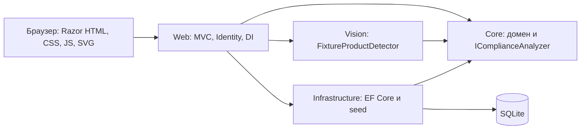

# Архитектура и требования

RetailVision помогает сравнить фактическую выкладку с эталонной последовательностью SKU. Цель — показать понятный путь от детекций к нарушениям, а не заявить недоказанную точность распознавания.

## Реализованный первый этап

Функции: просмотр каталога/планограмм, поиск товаров, три публичных fixture-аудита, подсветка нарушений, административный вход. Безопасность: посетители не меняют БД; все POST защищены CSRF; административные настройки требуют роль; нет фиксированного пароля. Производительность: fixture до восьми детекций, публичные операции ограничены 30 запросами/мин на IP. Алгоритм допускает максимум 500 ожидаемых и 500 обнаруженных позиций.

Core не зависит от MVC, EF или нейросети. Vision реализует интерфейс детектора из Core. В первом этапе `DetectionRequest` содержит только идентификатор fixture: при добавлении реального инференса этот контракт нужно расширить на безопасный поток изображения и параметры калибровки. Это ещё не контракт ONNX-инференса.

Web композиционно подключает реализации через DI. DbContext scoped, fixture-детектор и анализатор stateless singleton. Миграция и начальное заполнение выполняются при старте единственного экземпляра. Начальное заполнение транзакционное и не повторяется при существующем каталоге. Data Protection keys и SQLite хранятся вне wwwroot.

Razor кодирует пользовательские строки; CSP запрещает сторонние и inline-скрипты. Bootstrap/jQuery удалены как неиспользуемые. Все ассеты локальные, фотографии сторонних авторов отсутствуют.

## Дальнейшие требования

Полный продукт потребует CRUD с серверной валидацией, редактор, валидацию изображений до декодирования, ручную калибровку, ограниченную очередь CPU-инференса, снимки планограмм, историю исправлений и экспорты. В интерфейсе эти возможности не представлены как работающие. Docker/HTTPS и reverse proxy должны быть проверены перед публичным размещением.
