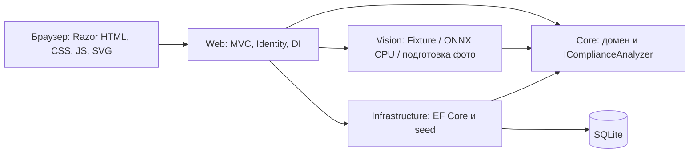

# Архитектура и требования

RetailVision помогает сравнить фактическую выкладку с эталонной последовательностью SKU. Цель — показать понятный путь от детекций к нарушениям, а не заявить недоказанную точность распознавания.

## Реализованные этапы 1–6

Функции: каталог с CRUD и фильтрами, визуальный редактор, JSON import/export, семь публичных fixture-аудитов, метрики и подсветка шести типов нарушений, административный вход. Посетители читают активный каталог и планограммы; все изменения и загруженные изображения требуют роль Administrator. Все POST защищены CSRF, включая Fetch-запрос сохранения JSON; фиксированного пароля нет. DEMO/вход ограничены 30 запросами/мин на IP. Алгоритм допускает максимум 500 ожидаемых и 500 обнаруженных позиций.

Core не зависит от MVC, EF или нейросети. Vision реализует IProductDetector: запрос содержит либо идентификатор fixture, либо байты подготовленного PNG. Контроллер DEMO использует только FixtureProductDetector; PhotoVisionService управляет отдельным OnnxProductDetector, ограниченной очередью и отменой. Смешение режимов запрещено. Контракт модели, доверенные файлы и преобразование координат описаны в [ML-пайплайне](ml-pipeline.md).

Web композиционно подключает реализации через DI. DbContext и PlanogramStore scoped, fixture-детектор и анализатор stateless singleton. ProductImageStore singleton ограничивает декодирование двумя параллельными операциями без очереди. Миграции и начальное заполнение выполняются при старте единственного экземпляра. Транзакционный seed помечается постоянным маркером и не восстанавливает удалённый администратором каталог. Data Protection keys, SQLite и изображения хранятся вне wwwroot.

PlanogramValidator в Core проверяет переносимый документ по набору допустимых SKU. PlanogramStore проверяет версию родителя и заменяет полки/позиции одной транзакцией. Product.Revision и Planogram.Version служат concurrency tokens. Старая версия получает HTTP 409; неверная планограмма — 422. Редактор сохраняет изменения в памяти до подтверждения сервера и предупреждает при уходе с несохранёнными правками.

DEMO не читает редактируемый каталог: эталон и нейтральные подписи зафиксированы в FixtureProductDetector. Изменение товаров или привязок модели не меняет результаты учебных сценариев.

IComplianceAnalyzer принимает позиции или PlanogramDocument, детекции и ComplianceOptions: каталог допустимых SKU, пороги, геометрию полок и стратегию. Core разворачивает фейсинги, определяет полку по нижней опорной точке и выполняет сопоставление без повторного использования объекта. ComplianceResult включает Matches, Violations, Metrics, Shelves и Facings. Неопределённость передаётся через IsCertain и отображается отдельно. [Методика](planogram-algorithm.md) описывает формулы и ограничения; сущности БД на этапе 3 не менялись.

Razor кодирует пользовательские строки; CSP запрещает сторонние и inline-скрипты. Bootstrap/jQuery удалены как неиспользуемые. Все ассеты локальные, фотографии сторонних авторов отсутствуют.

## Фото и постоянные отчёты

PhotoDraftStore хранит приватные черновики отдельно от таблиц Audit: PNG и атомарно заменяемый JSON содержат OwnerId, срок доступа, Revision, снимок эталона, калибровку и результат с версией/SHA модели. Все действия требуют Administrator, чтение — совпадения владельца, запись — CSRF и проверки версии. Используется один экземпляр приложения с ограниченным локальным хранилищем.

AuditStore (scoped) сохраняет независимый AuditSnapshot, текущие детекции и результат в SQLite. Успешный REAL-анализ сохраняется автоматически; DEMO — отдельным административным POST. PNG копируется в audit-photos, ключ не зависит от временного черновика. OwnerId проверяется для истории, изображений, JSON, печати и коррекции. Дашборд анонимного посетителя не раскрывает реальные данные.

AuditReview в Core валидирует ручные детекции и вызывает тот же анализатор. Исходная confidence неизменна; ConfirmedByHuman определяет эффективное подтверждение при сопоставлении. Транзакция SaveChanges обновляет Audit, дочерние Detections/Violations и AuditCorrection с состоянием до/после. Revision защищает от потерянных обновлений. Уникальный индекс OwnerId/SourceKey обеспечивает повторяемость сохранения без дублей.

HistoryController строит отчёт, фильтры, SQL-агрегаты аналитики и сравнение; AuditReport служит общей моделью обычного и печатного Razor-представления. JSON schemaVersion=1 содержит оригинал, текущую редакцию и журнал. Серверный PDF-renderer можно добавить поверх этой модели; сейчас используется печать браузера. [Руководство](history-and-reports.md).

Развёртывание: браузер подключается по HTTPS к Nginx, тот передаёт запрос единственному ASP.NET-процессу по внутренней Docker-сети. ReverseProxyConfiguration разрешает X-Forwarded-For/Proto только от явно заданного IP; Nginx перезаписывает клиентские заголовки. Kestrel не публикует порт хоста. App работает без root с read-only корнем, /tmp в tmpfs, данные и стабильные Data Protection keys — в постоянном /data. Модели монтируются отдельно read-only. Bootstrap читает Docker secret один раз при создании администратора. /health сообщает доступность БД, включая отсутствие модели как допустимый режим DEMO.

Backup останавливает app и копирует весь том; restore отказывается писать в непустой том. CI проверяет реальный Compose, TLS с временным сертификатом, native-зависимости и восстановление. [Развёртывание и границы проверки](deployment.md).

Локально обучена экспериментальная модель восьми SKU HoloSelecta; её качество пока недостаточно для автоматической приёмки ([измерения](experiments/holoselecta-v1/README.md)). Веса не входят в Git, публичного VPS нет. Архив автоматически не удаляется; политика хранения, мониторинг VPS и серверная генерация PDF остаются возможными расширениями.
