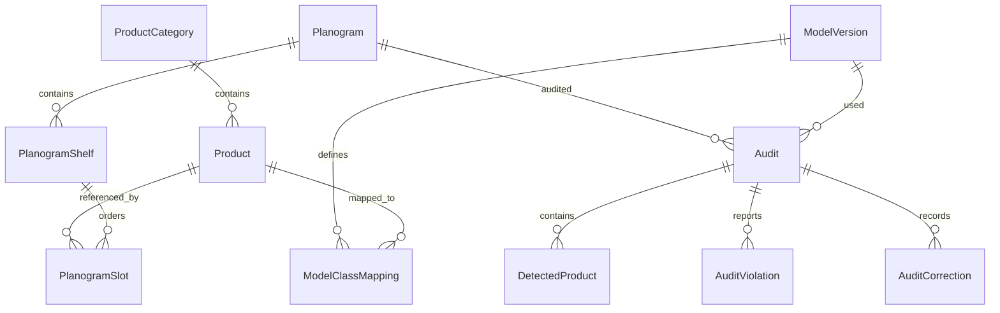

# База данных

EF Core 10.0.11, Microsoft SQLite provider. Первая migration — `InitialCreate`; runtime использует `MigrateAsync`, а не `EnsureCreated`. База не пересоздаётся при запуске. Временно тестовые БД изолированы от пользовательской базы.

- Product: ID, уникальный SKU, название, бренд, категория, размер упаковки, SVG-цвет/путь изображения, активность, дата UTC.
- ModelClassMapping: составной ключ `(ModelVersionId, ClassIndex)` и явная ссылка ProductId. Индекс класса 0 не равен ProductId 1.
- Planogram: название, описание, торговая зона и версия; полки нумеруются от 1.
- PlanogramSlot: порядок внутри полки, товар и количество фейсингов. В учебном эталоне фейсинги разворачиваются в восемь отдельных ожидаемых позиций.
- Audit: UTC, режим, ссылка на модель/планограмму, JSON-снимок планограммы, путь снимка, метрика. Таблица зарезервирована для этапа 5, UI пока не сохраняет аудит.
- DetectedProduct, AuditViolation, AuditCorrection: основа будущей истории. Связь исправления с конкретным объектом и автором потребует расширения на этапе 5.

Уникальные индексы запрещают одинаковые номера полок в планограмме и одинаковые порядковые номера позиций в одной полке. CHECK запрещает неположительные позиции/полки и фейсинги вне 1..100. Foreign keys включены. Удаление товара, категории, модели или планограммы, на которые ссылаются защищённые записи, ограничено `Restrict`. Identity использует стандартные таблицы пользователей/ролей и хранит хэши паролей.

Начальный каталог — шесть нейтральных SKU. Seed проверяет наличие товаров и выполняется один раз, в транзакции. Он не является механизмом восстановления частично изменённого пользователем каталога. Параллельный старт нескольких экземпляров пока не поддержан.
