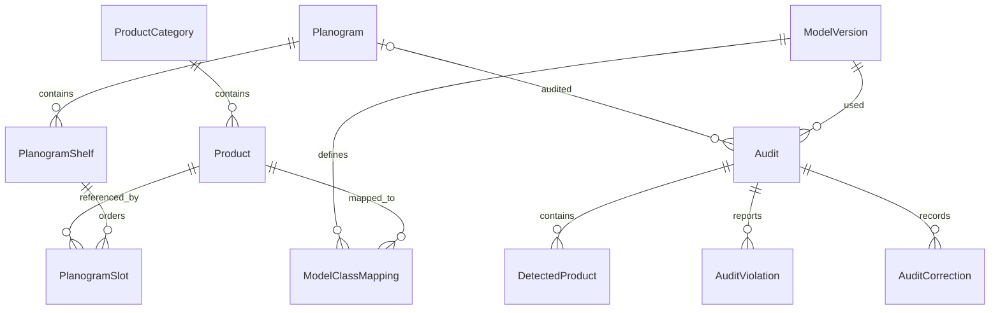

# База данных

Миграция AuditRetention добавляет nullable ArchivedAtUtc в Audit (старые записи остаются активными) и PendingPhotoDeletion — постоянную очередь удаления файлов после транзакционного удаления отчёта. Revision защищает корзину/восстановление/удаление от конкурентных изменений; дочерние детекции, нарушения и исправления удаляются каскадно. [Политика хранения](operations.md).

EF Core 10.0.11, Microsoft SQLite provider. Миграции: InitialCreate, CatalogEditing и AuditHistory; runtime использует MigrateAsync, а не EnsureCreated. База не пересоздаётся при запуске. Временные тестовые БД изолированы от пользовательской базы. CatalogEditing добавляет Revision = 1 существующим товарам, SeedMarker и ограничения классов модели. AuditHistory расширяет историю, не удаляя прежние записи; обновление с несколькими старыми аудитами проверено отдельно.

- Product: ID, уникальный SKU, название, бренд, категория, размер упаковки, SVG-цвет/ключ приватного изображения, активность, дата UTC, Revision — токен конкурентного сохранения.
- ModelClassMapping: составной ключ (ModelVersionId, ClassIndex), уникальная пара (ModelVersionId, ProductId) и CHECK ClassIndex >= 0. Один SKU соответствует одному классу каждой версии модели. Индекс класса 0 не равен ProductId 1.
- Planogram: название, описание, торговая зона и версия; полки нумеруются от 1.
- PlanogramSlot: порядок внутри полки, товар и количество фейсингов. В учебном эталоне фейсинги разворачиваются в восемь отдельных ожидаемых позиций.
- Audit: OwnerId, SourceKey, Revision, UTC, режим, ссылки на модель/планограмму, версия и имена эталона/модели, SHA, ключ PNG, неизменный SnapshotJson, CurrentDetectionsJson, ResultJson, исходный/текущий процент и счётчики. Планограмма может быть null для фиксированного DEMO; реальный эталон защищён Restrict.
- DetectedProduct/AuditViolation: текущие объекты и отклонения, заменяемые при пересчёте. Канонические полные данные, ID детекций и ручные подтверждения хранятся также в JSON.
- AuditCorrection: Revision, UTC, ActorId, причина, полный JSON до/после и результаты обоих расчётов. Журнал дополняется при коррекции и восстановлении, исходный SnapshotJson не меняется.

Индекс (OwnerId, SourceKey) уникален для непустых SourceKey: двойная отправка не создаёт дубль. Старые служебные строки без владельца/источника остаются без назначения пользователю и не появляются в приватной истории. Индекс (OwnerId, Mode, CreatedAtUtc) поддерживает фильтрацию; Audit.Revision — токен конкурентного обновления. Весь пересчёт и запись журнала выполняются одним SaveChanges. Постоянные PNG лежат вне wwwroot; БД содержит случайное имя, а не произвольный путь.

Уникальные индексы запрещают одинаковые номера полок в планограмме и одинаковые порядковые номера позиций в одной полке. CHECK запрещает неположительные позиции/полки и фейсинги вне 1..100. Foreign keys включены. Удаление товара, категории, модели или планограммы, на которые ссылаются защищённые записи, ограничено `Restrict`. Identity использует стандартные таблицы пользователей/ролей и хранит хэши паролей.

Начальный каталог — шесть нейтральных SKU. SeedMarker с ключом catalog-v1 фиксирует завершение seed. При обновлении существующий каталог получает маркер без перезаписи. Удаление всех товаров после этого не запускает seed заново. Параллельный старт нескольких экземпляров пока не поддержан.

Planogram.Version увеличивается после каждого успешного сохранения; версия и удаление старых/создание новых дочерних записей проверяются в одной транзакции. JSON import/export содержит SKU, номера полок/позиций и фейсинги, без внутренних ID. Импорт всегда создаёт новую планограмму.
