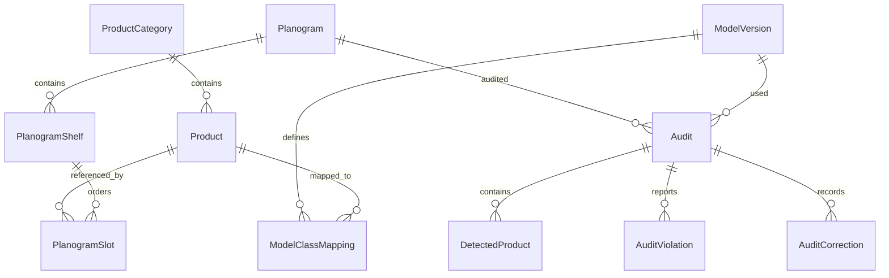

# База данных

EF Core 10.0.11, Microsoft SQLite provider. Миграции: InitialCreate и CatalogEditing; runtime использует MigrateAsync, а не EnsureCreated. База не пересоздаётся при запуске. Временные тестовые БД изолированы от пользовательской базы. CatalogEditing добавляет Revision = 1 существующим товарам, SeedMarker и ограничения классов модели; переход с InitialCreate проверен отдельным тестом.

- Product: ID, уникальный SKU, название, бренд, категория, размер упаковки, SVG-цвет/ключ приватного изображения, активность, дата UTC, Revision — токен конкурентного сохранения.
- ModelClassMapping: составной ключ (ModelVersionId, ClassIndex), уникальная пара (ModelVersionId, ProductId) и CHECK ClassIndex >= 0. Один SKU соответствует одному классу каждой версии модели. Индекс класса 0 не равен ProductId 1.
- Planogram: название, описание, торговая зона и версия; полки нумеруются от 1.
- PlanogramSlot: порядок внутри полки, товар и количество фейсингов. В учебном эталоне фейсинги разворачиваются в восемь отдельных ожидаемых позиций.
- Audit: UTC, режим, ссылка на модель/планограмму, JSON-снимок планограммы, путь снимка, метрика. Таблица зарезервирована для этапа 5, UI пока не сохраняет аудит.
- DetectedProduct, AuditViolation, AuditCorrection: основа будущей истории. Связь исправления с конкретным объектом и автором потребует расширения на этапе 5.

Уникальные индексы запрещают одинаковые номера полок в планограмме и одинаковые порядковые номера позиций в одной полке. CHECK запрещает неположительные позиции/полки и фейсинги вне 1..100. Foreign keys включены. Удаление товара, категории, модели или планограммы, на которые ссылаются защищённые записи, ограничено `Restrict`. Identity использует стандартные таблицы пользователей/ролей и хранит хэши паролей.

Начальный каталог — шесть нейтральных SKU. SeedMarker с ключом catalog-v1 фиксирует завершение seed. При обновлении существующий каталог получает маркер без перезаписи. Удаление всех товаров после этого не запускает seed заново. Параллельный старт нескольких экземпляров пока не поддержан.

Planogram.Version увеличивается после каждого успешного сохранения; версия и удаление старых/создание новых дочерних записей проверяются в одной транзакции. JSON import/export содержит SKU, номера полок/позиций и фейсинги, без внутренних ID. Импорт всегда создаёт новую планограмму.
